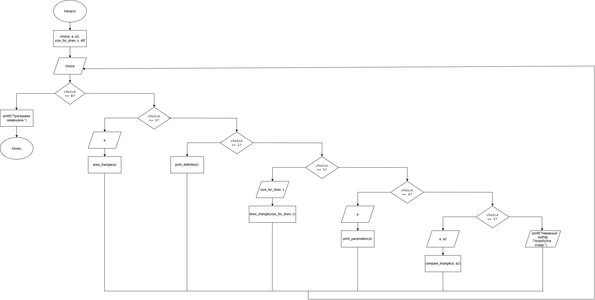

# Домашнее задание к работе 10
## Условие задачи
Составьте программу, которая для заданной пользователем фигуры, например прямоугольника (треугольника или другой фигуры см. ДЗ 9) предлагает меню выбора одной из операций:
1) рассчитать площадь; 
2) вывести определение фигуры; 
3) нарисовать фигуру;
4) вывести параметры фигуры;
5) сравнить по площади с другим треугольником.
## 1. Алгоритм и блок-схема
### Алгоритм решения
1. Начало
2. Объявить переменные:
   - номер выбора действия: choice
   - сторона треугольника: a, a2
   - высота треугольника: size_for_draw
   - символ для рисования: s
   - разница площадей: diff
3. Начало цикла do-while
4. Вывести на экран текст меню с пунктами от 0 до 5
5. Ввести значение переменной:
   - ввод значения choice
6. Выполнить выбор действия на основе choice:
   - Если choice = 1: ввести a, вычислить и вывести area_triangle(a)
   - Если choice = 2: вывести результат функции print_definition()
   - Если choice = 3: ввести size_for_draw и s, вызвать draw_triangle(size_for_draw, s)
   - Если choice = 4: ввести a, вызвать print_parameters(a)
   - Если choice = 5: ввести a и a2, вычислить diff = compare_triangle(a, a2) и вывести результат сравнения
   - Если choice = 0: вывести сообщение о завершении
7. Проверить условие: если choice != 0, вернуться к шагу 3 (повторить цикл)
8. Конец
### Блок-схема

## 2. Реализация программы
```
#define _CRT_SECURE_NO_WARNINGS
#include <stdio.h>
#include <locale.h>
#include <math.h>

float area_triangle(float a);
void print_definition();
void draw_triangle(int a, char s);
void print_parameters(float a);
float compare_triangle(float a1, float a2);

int main()
{
    setlocale(LC_ALL, "RUS");

    int choice;
    int size_for_draw;
    float a, a2;
    char s;
    float diff;
    do
    {
        printf("\n=============================================================\n");
        printf("                            МЕНЮ \n");
        printf("=============================================================\n");
        printf("1) Рассчитать площадь треугольника\n");
        printf("2) Вывести определение фигуры\n");
        printf("3) Нарисовать фигуру\n");
        printf("4) Вывести параметры фигуры\n");
        printf("5) Сравнить по площади с другим треугольником\n");
        printf("0) Выход\n");
        printf("-------------------------------------------------------------\n");
        printf("Выберите действие: ");
        scanf("%d", &choice);

        switch (choice)
        {
        case 1:
            printf("Введите длину стороны: ");
            scanf("%f", &a);
            printf("-------------------------------------------------------------\n");
            printf("Площадь треугольника: %.2f\n", area_triangle(a));
            break;

        case 2:
            printf("-------------------------------------------------------------\n");
            print_definition();
            break;

        case 3:
            printf("Введите сторону треугольника: ");
            scanf("%d", &size_for_draw);
            printf("Введите символ: ");
            scanf(" %c", &s);
            printf("-------------------------------------------------------------\n");
            draw_triangle(size_for_draw, s);
            break;

        case 4:
            printf("Введите длину стороны: ");
            scanf("%f", &a);
            printf("-------------------------------------------------------------\n");
            print_parameters(a);
            break;

        case 5:
            printf("Введите сторону первого треугольника: ");
            scanf("%f", &a);
            printf("Введите сторону второго треугольника: ");
            scanf("%f", &a2);
            printf("-------------------------------------------------------------\n");

            diff = compare_triangle(a, a2);
            if (diff > 0.0001) {
                printf("Первый треугольник больше второго на %.2f\n", diff);
            }
            else if (diff < -0.0001) {
                printf("Второй треугольник больше первого на %.2f\n", fabs(diff));
            }
            else {
                printf("Площади треугольников равны.\n");
            }
            break;

        case 0:
            printf("Программа завершена.\n");
            break;

        default:
            printf("Неверный выбор. Попробуйте снова.\n");
        }
    } while (choice != 0);

    return 0;
}

float area_triangle(float a)
{
    return (sqrt(3.0) / 4.0) * a * a;
}

void print_definition()
{
    printf("Равносторонний треугольник — это треугольник, у которого все три стороны равны, а все углы равны 60 градусам.\n");
}

void draw_triangle(int a, char s)
{
    for (int i = 1; i <= a; i++)
    {
        for (int j = 0; j < i - 1; j++)
            printf(" ");
        for (int j = 1; j <= 2 * (a - i + 1) - 1; j++)
        {
            if (i == 1 || j == 1 || j == 2 * (a - i + 1) - 1)
                printf("%c", s);
            else
                printf(" ");
        }
        printf("\n");
    }
}

void print_parameters(float a)
{
    printf("Параметры фигуры:\n");
    printf("Сторона A = %.2f\n", a);
    printf("Периметр  = %.2f\n", 3 * a);
    printf("Высота    = %.2f\n", (sqrt(3.0) / 2.0) * a);
}

float compare_triangle(float a1, float a2)
{
    float s1 = area_triangle(a1);
    float s2 = area_triangle(a2);
    return s1 - s2;
}
```
## 3. Результат работы программы
```

=============================================================
                            МЕНЮ
=============================================================
1) Рассчитать площадь треугольника
2) Вывести определение фигуры
3) Нарисовать фигуру
4) Вывести параметры фигуры
5) Сравнить по площади с другим треугольником
0) Выход
-------------------------------------------------------------
Выберите действие: 2
-------------------------------------------------------------
Равносторонний треугольник - это треугольник, у которого все три стороны равны, а все углы равны 60 градусам.

=============================================================
                            МЕНЮ
=============================================================
1) Рассчитать площадь треугольника
2) Вывести определение фигуры
3) Нарисовать фигуру
4) Вывести параметры фигуры
5) Сравнить по площади с другим треугольником
0) Выход
-------------------------------------------------------------
Выберите действие: 4
Введите длину стороны: 7
-------------------------------------------------------------
Параметры фигуры:
Сторона A = 7,00
Периметр  = 21,00
Высота    = 6,06

=============================================================
                            МЕНЮ
=============================================================
1) Рассчитать площадь треугольника
2) Вывести определение фигуры
3) Нарисовать фигуру
4) Вывести параметры фигуры
5) Сравнить по площади с другим треугольником
0) Выход
-------------------------------------------------------------
Выберите действие: 0
Программа завершена.
```
## 4. Информация о разработчике
**Холодова Елизавета Юрьевна бИЦТ-262**
